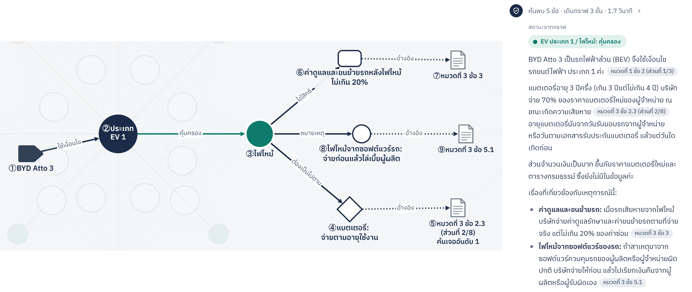
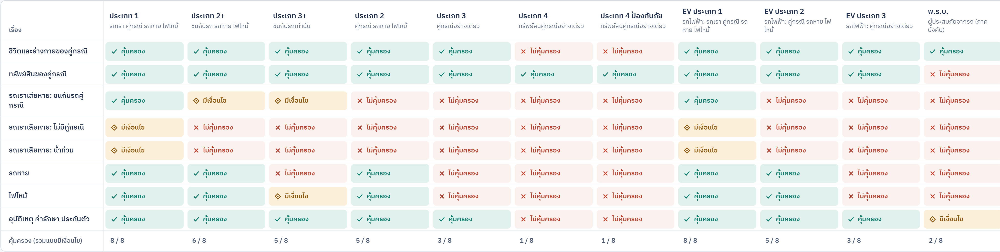

# GraphRAG Motor Insurance Coverage Map

**An interactive knowledge graph and AI assistant for Thai motor insurance policy wordings.**
Ask a question in plain Thai ("I have a BYD Atto 3 with Type 1 cover and it caught fire — am I covered?")
and get an answer grounded in the actual policy clauses, with the reasoning path drawn live on a graph.


<p align="center">
  
</p>

---

## Contents

- [Features](#features)
- [Quick start](#quick-start)
- [Configuration](#configuration)
- [How it works](#how-it-works)
- [Project structure](#project-structure)
- [Data pipeline](#data-pipeline)
- [Answer feedback](#answer-feedback)
- [Limitations](#limitations)
- [License](#license)
- [Disclaimer](#disclaimer)

## Features

- **Coverage matrix:** 11 plans × 8 coverage topics at a glance. Click any cell to see the conditions and the exact clauses it rests on.
- **Live knowledge graph:** each question lights up the path it took (vehicle → plan → coverage → conditions → clause), built with Cytoscape.js.
- **Grounded AI chat:** Claude answers by calling tools that query the graph and the policy text, and every claim carries a clause citation.
- **Hybrid retrieval:** a hand-reviewed coverage graph combined with BM25 full-text search over 901 clause chunks.
- **Question router:** detects plans, coverage topics, events, the vehicle model (and whether it is an EV), question type, and out-of-scope questions, before any LLM call.
- **Works without an API key:** the matrix, the graph and the preset example questions all run offline. Only free-text chat needs Claude.
- **Chat UX:** history kept in the browser, search (`Ctrl+K`), new chat (`Ctrl+Shift+O`), pin, rename, edit-and-resend, and mobile layout.
- **Feedback loop:** 👍/👎 on every answer, logged by the server and turned into regression test candidates.

<p align="center">
  
</p>

## Quick start

**Requirements:** Node.js **22.9 or newer** (`npm start` uses `--env-file-if-exists`). Check with `node --version`.
An [Anthropic API key](https://console.anthropic.com/) is optional and only needed for free-text chat.

```bash
git clone https://github.com/Nothingtaro/graphrag-insurance-map.git
cd graphrag-insurance-map
npm install
```

Create `.env` from the template and put your key in it (skip this to run without chat):

| macOS / Linux / Git Bash | Windows PowerShell | Windows cmd |
|---|---|---|
| `cp .env.example .env` | `Copy-Item .env.example .env` | `copy .env.example .env` |

```bash
npm start                 # open http://localhost:5173
```

That's all. The built graph (`public/js/data.js`) is committed, so Python is **not** needed to run the app.
Python is only needed if you want to [rebuild the data](#data-pipeline) from the PDFs.

### Troubleshooting

| Symptom | Fix |
|---|---|
| `node: bad option: --env-file-if-exists` | Node.js is older than 22.9. Upgrade Node. |
| `EADDRINUSE` on start | Port 5173 is taken. Set `PORT=5180` in `.env`. |
| Chat replies with an error | `ANTHROPIC_API_KEY` is missing or invalid in `.env`. Restart `npm start` after editing it. |
| Can't open the app from another device | The server only listens on `127.0.0.1` (this machine), by design, to keep your API key private. |
| `build_data.py` fails with "ไม่พบ …" (not found) errors | A different PyMuPDF version is installed. Use a fresh virtual environment with `ingest/requirements.txt` (pinned versions). |

## Configuration

All settings are environment variables, read from `.env`:

| Variable | Default | Description |
|---|---|---|
| `ANTHROPIC_API_KEY` | none | Needed for chat. It stays on the server and is never sent to the browser. |
| `GRAPHRAG_MODEL` | `claude-sonnet-5-5` | Claude model used for chat |
| `GRAPHRAG_EFFORT` | `medium` | Reasoning effort |
| `PORT` | `5173` | Server port (binds to `127.0.0.1`) |
| `GRAPHRAG_FEEDBACK_LOG` | `feedback/feedback.jsonl` | Where answer feedback is appended |

Server-side refusal fallback (`fallbacks: "default"`) is enabled: if the model refuses, the request is retried on a fallback model within the same call.

## How it works

```
 question ──► route.js ──────────► plans, coverages, vehicle (EV?), event, question type, in/out of scope
                │
                ▼
          app.js (browser)
          ├─ graph lookup ──────► data.js: plans → coverages → conditions / exclusions → clauses
          ├─ BM25 search ───────► 901 clause chunks
          └─ tool loop ◄──────► claude-local.js ──► server.mjs ──► Claude API (streaming)
                │
                ▼
     cited answer  +  highlighted path on the graph
```

The tool loop runs **in the browser** because each tool call also moves the graph on screen.
`server.mjs` is a thin streaming proxy to the Claude API that keeps the key server-side. The tools are:

| Tool | Purpose |
|---|---|
| `search_chunks` / `search_terms` | Full-text search over clauses and defined terms |
| `get_coverage` | Coverage status and conditions for a plan × topic |
| `get_plan_overview` | Everything one plan covers |
| `compare_plans` | Side-by-side comparison of plans |
| `get_clause` | The exact text of a cited clause |
| `get_policy_terms` | General policy terms (no-claim discount, cancellation and refund, vehicle transfer, claim notice, …) |

## Project structure

```
server.mjs                   Node server: serves public/, proxies POST /api/messages, logs POST /api/feedback
public/
  index.html                 Page markup
  css/                       App styles and fonts (IBM Plex Sans Thai, Sarabun)
  vendor/                    Cytoscape.js 3.35.0 (unmodified)
  js/data.js                 Graph + policy clauses: GENERATED by ingest/build_data.py, do not edit
  js/app.js                  App: graph rendering, BM25, retrieval, tools, chat
  js/route.js                Question router (DOM-free, testable in Node)
  js/claude-local.js         Browser client for server.mjs
ingest/                      PDF → data.js pipeline, tests and eval set (see ingest/README.md)
doc/                         Source policy wordings (PDF)
research/b19_review/         Review page for interpretive readings (for the claims team)
```

## Data pipeline

The graph is built from the policy PDFs in `doc/` by a Python pipeline in [`ingest/`](ingest/README.md):

1. **Extract:** read the PDFs with PyMuPDF and repair broken Thai glyphs (duplicated tone marks, stray glyphs, zero-width spacing), recover tables, and measure quality. Dictionary coverage of the 2025 edition goes from ~76% to ~99.6%.
2. **Structure:** split pages into sections, clauses and chunks.
3. **Build:** merge them with the hand-reviewed coverage graph (`ingest/graph.py`, `ingest/graph_ext.py`), check every reference, and write `public/js/data.js`.

Requires **Python 3.11+**. Use a virtual environment: the library versions are pinned, because a different PyMuPDF version extracts text differently and the build checks then fail.

```bash
python -m venv .venv
source .venv/bin/activate                          # Windows: .venv\Scripts\activate
pip install -r ingest/requirements.txt             # pymupdf, pythainlp (pinned)

python -I ingest/extract.py                        # PDF → ingest/out/pages/*.json
python -I ingest/build_data.py                     # → public/js/data.js
python -I -m unittest discover -s ingest/tests -v  # unit tests
npm run eval                                       # router + BM25 eval set, fails on regression
```

With the pinned versions, rebuilding reproduces the committed `data.js` byte for byte. `ingest/out/` is generated and not committed.

**Current dataset:** 10 documents · 901 chunks · 11 plans (Type 1, 2+, 3+, 2, 3, 4, 4 Protection, EV Type 1–3, and Compulsory Motor Insurance) × 8 coverage topics · 213 condition/exclusion/deductible/entitlement nodes · 10 general policy terms.
Wordings are the 1 January 2025 edition, except Type 4, Type 4 Protection and Compulsory Motor Insurance, which are still the 2020 edition.

## Answer feedback

Every answer has 👍/👎, and 👎 can add a reason and comment. The server appends one JSON line per rating to `feedback/feedback.jsonl`, holding the question, answer, cited clauses, router output and data version. It does not store user identity. Ratings that fail to send are queued in the browser and retried.

```bash
node ingest/feedback_report.mjs             # summary → ingest/out/feedback.md
node ingest/feedback_report.mjs --to-eval   # draft eval cases from 👎 → ingest/eval/candidates.json
```

## Limitations

- **Older editions:** Type 4, Type 4 Protection and Compulsory Motor Insurance use the 2020 wordings, because no newer edition is in `doc/`.
- **Out of scope:** other insurance types, premium prices and choosing an insurer get a standard reply; that data is not in the system.
- **Off-topic questions:** questions unrelated to insurance or cars do not touch the graph. Mid-conversation follow-ups ("explain more") are answered from the chat context.
- **Schedule amounts:** sums insured and deductibles "as stated in the schedule" vary per policy and are not in the data.
- **Interpretive readings:** 42 graph edges are interpretations, not literal wording (e.g. flood under Type 1). 35 are provisionally accepted ([`ingest/interp_review.py`](ingest/interp_review.py)) and still awaiting claims-team confirmation ([`research/b19_review/`](research/b19_review/README.md)).

## License

The source code in this repository is released under the [MIT License](LICENSE), Copyright (c) 2026 Chanon A.

The MIT License does **not** cover:

- **Policy wordings:** the PDFs in `doc/` and the policy text derived from them in `public/js/data.js` belong to their respective publishers.
- **Third-party files:** Cytoscape.js (`public/vendor/`, MIT, The Cytoscape Consortium, license header kept in the file) and the IBM Plex Sans Thai and Sarabun web fonts (`public/fonts/`, distributed under the SIL Open Font License 1.1 by their authors).

## Disclaimer

This is an independent research project. It is **not** insurance or legal advice and is not affiliated with any insurer.
Always check the policy wording and schedule of your own policy. The policy documents in `doc/` belong to their respective publishers.
